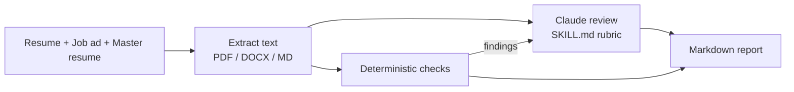

# AI Resume Reviewer

A recruiter-style resume reviewer that compares a resume against a specific job ad, using Claude for judgement and deterministic Python checks for the facts.

I built it while applying for graduate roles, and used it on **9 job ads** across research, consulting, analytics and software engineering. It gives a match score, a requirement-by-requirement table, keyword gaps, and what to pull in from a longer "master" resume.

## Why two layers

Using AI on my own applications taught me that the model is good at judgement (is this bullet strong? does it match the role?) but can let simple factual errors through. One of my resumes said *"60% of 4 users hit problems"*, which is 2.4 people, and the error was copied into three tailored versions before I caught it.

So the tool never trusts the AI alone:

| Layer | What it does | Where |
|---|---|---|
| **Deterministic checks** | Impossible percentages ("X% of N" that isn't a whole number), buzzwords, bullets with no metrics, figures that differ from the master resume | [`checks.py`](src/resume_review/checks.py) |
| **AI review** | Recruiter-style judgement: first impression, weak lines with rewrites, a requirement match table, gaps, top 5 fixes | [`SKILL.md`](skill/SKILL.md) |
| **Hand-off** | The check results are passed to the model, which must confirm or dismiss each one. Both appear in the final report. | [`cli.py`](src/resume_review/cli.py) |



## What the review covers

1. **Hard requirements and accuracy first**: citizenship, start date and closing date; impossible numbers; figures that don't match the master resume; overstated wording.
2. **First impression**: shortlist Yes / Maybe / No, and a match score out of 100.
3. **Weak areas**: the weak line quoted, why it's weak, and a rewrite.
4. **Buzzwords and missing metrics**, with placeholders like `[X]`. It never invents numbers.
5. **Job ad match table**: each requirement as ✅ / ⚠️ / ❌, plus missing keywords in the ad's exact wording.
6. **What to add from the master resume**, what to cut, and gaps neither resume covers.
7. **Top 5 fixes**, ranked by impact.

## Use it

```bash
pip install -e .
export ANTHROPIC_API_KEY=sk-...

# Full review
resume-review --resume cv.pdf --job job_ad.txt --master master.pdf --out review.md

# Checks only (no API key needed)
resume-review --resume examples/resume.md --job examples/job_ad.txt --master examples/master_resume.md --checks-only

# See the exact prompt without calling the API
resume-review --resume examples/resume.md --job examples/job_ad.txt --dry-run
```

The model defaults to `claude-sonnet-5-5`; change it with `--model` or `RESUME_REVIEW_MODEL`.

`SKILL.md` also works on its own as a Claude skill: add it to Claude and ask it to review your resume against a job ad.

### Example output (checks on the sample resume)

| Check | Detail |
|---|---|
| Impossible percentage | "70% of 5" works out to 3.5 people/items. Check where the percentage really came from. |
| Buzzword | "detail-oriented" appears 1x. Replace it with evidence. |
| No metric | "Responsible for updating weekly reports in Excel." |

## How I check the AI's output

- **Every number is checked against its source.** The tool never fills in metrics. It leaves `[X]` for me to fill in.
- **Cross-version consistency.** Tailored resumes drift from the master, so figures are compared automatically.
- **The rubric is a file, not a chat.** `SKILL.md` is versioned, so changes to the rubric are reviewed like code. Examples: adding the master-resume section, and adding the accuracy check after the "60% of 4" error.
- **Tests** cover each deterministic check: `pytest`.

## Project layout

```
skill/SKILL.md              The review rubric (also usable as a Claude skill)
src/resume_review/checks.py Deterministic checks
src/resume_review/cli.py    Command-line tool
examples/                   Fictional job ad, resume and master resume
tests/                      Unit tests for the checks
```

## Privacy

Don't commit real resumes. `.gitignore` excludes `private/` and `*.pdf` / `*.docx`, and the examples are fictional.

## Built with

Python, the Anthropic API, pypdf, python-docx and pytest. I designed the rubric and the checks and validated the outputs; I used Claude as a coding and drafting partner while building it.
